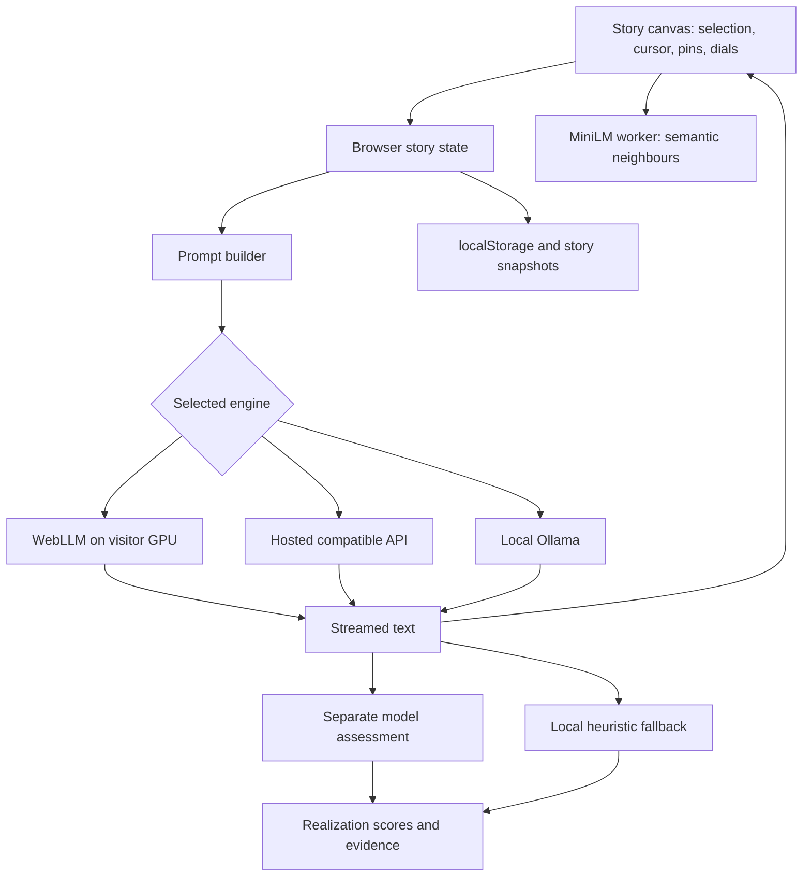

# Story Steer Studio: Project Concept, AI Architecture, and Recruiter Guide

**Documentation date:** November 20, 2026

**Audience:** Recruiters, hiring managers, engineering interviewers, and developers

**Scope:** The implemented application in this repository. Proposed improvements are identified separately.

[Live application](https://story-steer-studio-visha.vishalfulsundar2024.chatgpt.site/) · [Repository README](../README.md) · [Verification record](../VERIFICATION.md)

## 1. The project in one sentence

Story Steer Studio is an interactive generative AI writing application that lets a person influence a story through selected phrases, weighted concepts, visual narrative controls, and a movable continuation cursor, then inspect how well the resulting text reflects those choices.

## 2. A recruiter-friendly introduction

### The problem

AI writing tools can produce a large amount of text quickly, but directing that text can require repeated prompting and rewriting. A writer may know that a scene should be more tense, more tender, or more focused on one character without wanting to describe all of those changes in a new prompt every time. Exploring an alternative from an earlier sentence also needs a way to preserve the original draft.

### The solution

Story Steer Studio puts those choices directly beside the story. A writer can select an important phrase, pin a concept, turn a tone or pacing dial, or move the continuation cursor to an earlier word. The application translates the interaction into structured model instructions, streams a continuation, and displays an assessment of the requested qualities.

The project explores a practical question: **how can a person direct and evaluate an AI-generated narrative through a visual editor?**

### Why this project matters

Its value lies in the connection between a human intention, a concrete model request, and observable output. It demonstrates AI application engineering alongside interface design: streaming, cancellation, state preservation, model integration, local inference, semantic lookup, and evaluation all support the same writing workflow.

It is a portfolio application, not a claim that the creator trained a foundation model or achieved a scientifically validated method of controlling one.

### A 30-second explanation

> Story Steer Studio is a browser-based AI storytelling editor. Instead of repeatedly typing prompts, I can select phrases, pin concepts, and adjust controls such as tension, pace, and tone. The app sends those choices to a live model, streams the continuation, and checks the result. It can run an open model on the visitor's GPU without an API key, or connect to hosted models. I focused on making the controls traceable, preserving drafts, and clearly distinguishing real measurements from estimates.

### A two-minute technical explanation

> The application is a static website with dynamic client-side behavior. A provider layer supports browser inference through WebLLM and OpenAI-compatible streaming endpoints, including Hugging Face and local Ollama. The editor stores selected text, numeric priorities, pins, and narrative settings as structured state. A prompt builder combines those controls with the premise and story context. During generation, a committed steering change cancels the current request and restarts the unfinished suffix while preserving complete sentences. A separate MiniLM embedding worker supports semantic neighbours. A second model call assesses the generated paragraph without receiving the requested percentages; lexical heuristics provide an explicitly labeled fallback. The project also includes cursor-based branching, snapshots, import/export, provider error handling, and regression tests.

These explanations describe the implementation. They should not be expanded into claims of user adoption, commercial impact, benchmark accuracy, or production reliability without additional evidence.

## 3. The core user experience

The story occupies the main canvas: black background, white monospace text, and a compact left rail. There is no permanent sidebar. Connection settings, the premise, and saved drafts live behind the setup gear.

1. **Generate:** a model writes a continuation, with incoming text rendered as it arrives.
2. **Steer:** select phrases, pin concepts, or adjust narrative controls, then generate again.

The primary controls are Generate next, Steer, Rewrite last, and Stop during generation. The editor also supports:

- **Attention boxes:** selected phrases receive red underlines and a priority value. The exact phrase is included in the next generation request.
- **Pins:** concepts receive a strength percentage. Alt-drag upward sets strength; the word inspector also offers an explicit Pin action. Ordinary dragging remains text selection.
- **Inline removal:** the × beside a selected phrase removes its underline; Clear attention removes all boxes.
- **Polar dials:** angle chooses a narrative quality and distance sets strength. Closed dials become labeled points that can be reopened.
- **Movable cursor:** drag ⊕ backward or forward to choose the next continuation point. Later text dims until a branch is generated.
- **Draft recovery:** generating a branch saves the earlier draft to Library. Moving the cursor alone does not delete the later text.
- **Word inspection:** a popup supplies semantic neighbours and suggested next directions.
- **Optional branch scrubber:** releasing the slider creates an alternative to the last paragraph. It is not deterministic playback of a latent trajectory.

### Narrative dimensions

| Dimension | Current choices | Intended effect |
| --- | --- | --- |
| Tension | Relaxed, strained | Emotional pressure or suspense |
| Pace | Lingering, measured, flowing, brisk, urgent, breakneck | The rhythm and speed of events |
| Tone | Airy, tender, somber, wondrous | The emotional character of the prose |
| Focus | Detected character names and narrator | What or whom the continuation emphasizes |
| Resolution | Open-ended, resolved | How much closure the continuation offers |

These are instructions to the model, not guarantees. For example, a high tender setting and high strained setting ask for tenderness within a tense situation; the model still has to interpret their combination.

## 4. Architecture and data flow



The diagram is conceptual: hosted API connections require credentials and browser access policies where applicable. It does not represent an application-owned inference server.

| Component | Responsibility | Source |
| --- | --- | --- |
| Canvas and editor | Rendering, selection, cursor dragging, dials, history, setup | [`app.js`](../dist/app.js), [`index.html`](../dist/index.html) |
| Story logic | Prompt construction, branching, extraction, local relevance and scoring | [`core.js`](../dist/core.js) |
| Model transport | Engine loading, compatible API calls, streaming parser, model checker | [`providers.js`](../dist/providers.js) |
| Semantic client | Worker requests and timeouts | [`semantics.js`](../dist/semantics.js) |
| Semantic worker | Local embeddings, caching, cosine ranking | [`semantics-worker.js`](../dist/semantics-worker.js) |
| Presentation | Responsive layout and interaction feedback | [`styles.css`](../dist/styles.css) |
| Local preview | Static HTTP file serving | [`server.mjs`](../server.mjs) |
| Validation | Regression tests and a development-only HTTP fixture | [`tests/`](../tests/) |

The runtime uses vanilla JavaScript, HTML, and CSS. Remote, version-pinned libraries provide model inference. No React framework, application database, or inference backend is bundled.

## 5. Generative AI concepts behind the application

### Tokens and autoregressive generation

A language model processes tokens, which may represent words, parts of words, punctuation, or other text units. The application's displayed word count is therefore different from a provider's token count.

A useful mathematical description of autoregressive generation is:

```text
P(output | context) = product over t of P(token_t | context, token_1 ... token_(t-1))
```

The model repeatedly predicts a distribution over possible next tokens. A decoding procedure selects a token, adds it to the context, and continues. The request's story, premise, and steering instructions affect this conditional distribution.

Streaming exposes partial results while generation is still happening. A network chunk is not necessarily one token or one word: transport can combine or split text independently of the tokenizer.

### Context engineering

The application supplies a system instruction and a structured user payload. The system instruction asks for story prose, continuity, proportional interpretation of priorities, and a continuation rather than commentary. The payload contains the premise, earlier text, attention phrases, pins, narrative settings, and optional direction or partial paragraph.

This is inference-time context engineering. The model's parameters are not updated when a user selects a phrase or moves a dial.

### Sampling temperature

The provider layer defaults to temperature `0.85` for story generation and `0.25` for structured model tasks. Conceptually, temperature rescales output logits before sampling:

```text
P(next token = i) = softmax(logit_i / temperature)
```

Lower temperatures generally concentrate the distribution; higher temperatures broaden it. Temperature is not a direct measure of quality or a guarantee of creativity. Provider implementations and model behavior can differ. It is a decoding setting, separate from the app's tone and pacing percentages.

### Pretrained models rather than a training pipeline

The application uses existing instruction-following models. It does not collect a training dataset, optimize model parameters, perform supervised fine-tuning, or train a reward model. Downloading a browser model loads an existing model for inference; it does not train that model in the browser.

For a primary explanation of autoregressive language models, see the [Hugging Face causal language modeling documentation](https://huggingface.co/docs/transformers/tasks/language_modeling).

## 6. What “weights” means: five different quantities

This distinction is essential when explaining the project to an interviewer.

| Quantity | Meaning | Does the user change it here? |
| --- | --- | --- |
| Learned model parameters | Numeric tensors learned during model training | No |
| Internal attention coefficients | Context-dependent mixing scores computed inside attention layers | No direct access or control |
| App steering priorities | Phrase weights, pin percentages, and narrative strengths serialized into prompts | Yes |
| Semantic similarity | A comparison between embedding vectors | The user chooses the lookup, not its measured result |
| Realization score | A model assessment or local heuristic applied to generated text | The user chooses the target, not the score directly |

### 6.1 Learned model parameters

A neural network contains learned numbers in matrices and other tensors. A simplified layer computation is:

```text
y = activation(Wx + b)
```

Here, `W` and `b` are learned parameters. During training, an optimizer adjusts parameters to reduce an objective, often including next-token prediction loss. During ordinary inference they remain fixed while the model processes different input.

For a small numerical illustration, take input values `[0.2, 0.5, 0.1]`, coefficients `[0.8, -0.4, 0.6]`, and bias `0.1`. The weighted sum before an activation is:

```text
(0.2 × 0.8) + (0.5 × -0.4) + (0.1 × 0.6) + 0.1 = 0.12
```

Real models perform many large tensor operations; this example only illustrates a weighted sum. The individual input values are not the app's selected words or dial settings.

A simplified training update is `parameters_new = parameters_old − learning_rate × loss_gradient`. Backpropagation estimates how changing parameters would affect prediction error, and an optimizer uses that information to update them. Pretraining learns general patterns from data; instruction tuning further shapes a model's response to instructions. None of those training updates takes place when this app generates a paragraph. Instead, inference passes the new context through the already-trained network.

A “0.5B” model name refers approximately to half a billion parameters; it does not mean half a billion manually written rules. Parameter count alone does not determine instruction-following quality. Architecture, training, quantization, context, and decoding also matter.

**A pin labeled `forest (85%)` does not set a neuron or model parameter to 0.85.** It adds an instruction to the model's context.

### 6.2 Internal attention

A simplified attention head computes projections of its input and uses them to combine information across token positions:

```text
Q = XW_Q; K = XW_K; V = XW_V
attention = softmax((QK^T / sqrt(d_k)) + causal_mask)
output = attention V
```

The projection matrices are learned parameters. The attention coefficients are recomputed for the input; the causal mask prevents a token from attending to future positions. Multiple heads and layers participate in the model's computation.

The app does not obtain these attention matrices or edit their values. The left rail is an application-level relevance display. It should not be presented as a visualization of the foundation model's internal attention. See [Attention Is All You Need](https://arxiv.org/abs/1706.03762) for the foundational mechanism.

### 6.3 Application attention-box weights

An attention box stores a paragraph ID, character offsets, its exact selected text, and a weight. New selections default to `2.51`; the editor allows values from `1` to `4`.

For example:

```json
{
  "exact_text": "hidden clearing",
  "weight": 2.51
}
```

The system prompt tells the model to give higher-weighted excerpts more influence. The number is not multiplied into an internal attention tensor. A weight of `4` does not prove four times as much influence as a weight of `1`, because model interpretation is not calibrated to that scale.

### 6.4 Pin strength

For an upward Alt-drag distance `dy` in screen pixels, the UI maps distance to strength approximately as follows:

```text
pin_strength = round(clamp(20 + 0.6 × dy, 20, 100))
```

A 100-pixel upward drag therefore produces approximately 80%. Clicking a semantic neighbour or using the inspector Pin action initially uses 75%.

The model receives a string such as:

```text
forest (80%)
```

This expresses relative creative emphasis. It is not the probability that the next paragraph will contain the word, and the model can fulfill the intent through related imagery without repeating the literal word.

### 6.5 Narrative dial strength

The dial measures the pointer relative to its origin in SVG coordinates. Angle selects the closest label along the supported arc; radius determines strength:

```text
radius = sqrt(x² + y²)
strength = round(clamp(radius / 1.8, 0, 100))
```

The full-strength radius is 180 SVG units. The 25/50/75 rings are visual landmarks. Screen coordinates are normalized into the SVG coordinate system, so the calculation is not simply raw pointer distance on every screen size.

An 80% tone setting becomes `tone: tender (80%)` in the prompt. The word “vector” describes the app's directional control; the current implementation does not add a learned steering vector to hidden model activations.

## 7. How a steering request reaches the model

The prompt builder in `core.js` serializes the actual control state. An abbreviated example is:

```json
{
  "premise": "A wanderer follows a forgotten lullaby into a forest.",
  "story_so_far": "Elara reached the old gate...",
  "steering": {
    "attention": [{ "exact_text": "hidden clearing", "weight": 2.51 }],
    "pins": ["forest (85%)"],
    "vectors": ["tone: tender (79%)", "tension: strained (70%)"]
  },
  "partial_paragraph": "She rested her hand on the gate. "
}
```

This is an illustrative payload, not a claim that these settings guarantee a specific result.

The data path is:

1. Capture the interaction and update browser state.
2. Preserve the exact selected excerpt and current control values.
3. Build messages containing the story context and steering instructions.
4. Send them to the selected engine.
5. Render incoming text while preserving cancellation support.
6. Assess the resulting paragraph and save the current draft.

The system instruction asks the model to treat story excerpts as narrative data rather than overriding instructions. This reduces ambiguity but does not establish a comprehensive prompt-injection defense.

## 8. How the left rail calculates relevance

The rail uses local lexical overlap, not embeddings or model-attention tensors. Its context combines selected excerpts, pinned words, and the last 35 words of the story.

For a displayed line:

```text
M = number of line-token occurrences matching the context vocabulary
N = number of line tokens
relevance = min(1, M / max(2, 0.22 × N))
automatic_display_weight = 1 + 2.5 × relevance
```

The context vocabulary ignores words of length three or less. A line covered by an attention box displays that box's weight instead of the automatic weight. The bar uses 12 small segments, with brighter segments based on relevance and red accents for a box.

**Example:** a line with 10 tokens and 2 matches has relevance `2 / 2.2 ≈ 0.91`, giving an automatic weight of approximately `3.27`.

Important limits:

- Repeated matches count as repeated occurrences.
- Similar meaning without shared wording may be missed.
- The calculation uses existing context; it does not see a future paragraph before generation.
- Numeric box weights are sent to the writer, but the rail's context-overlap calculation itself does not numerically weight those words by their box values.

This display is useful feedback about application context. Calling it a reliable predictor of future output would overstate the implementation.

## 9. Semantic neighbours and embeddings

The word inspector can run the `Xenova/all-MiniLM-L6-v2` embedding model locally through Transformers.js in a Web Worker. It uses mean pooling and normalization, caches computed embeddings, and ranks up to 180 candidate words. The worker returns the top three neighbours.

For two vectors `u` and `v`:

```text
cosine_similarity(u, v) = (u · v) / (||u|| × ||v||)
```

Because the embeddings are normalized, the dot product gives cosine similarity. The displayed value is rounded after multiplication by 100 and clamped into the 0–100 range. Negative similarities are therefore displayed as zero.

MiniLM embeddings encode semantic relationships, which can connect words that do not share spelling. The original [MiniLM model card](https://huggingface.co/sentence-transformers/all-MiniLM-L6-v2) describes a 384-dimensional representation. The app uses its published ONNX conversion for local inference.

The candidate vocabulary is bounded and includes story words and a built-in vocabulary. These are the closest available candidates, not necessarily the nearest words in the entire language. Applying a sentence embedding model to isolated words also loses contextual nuance.

The inspector displays immediate lexical estimates while asynchronous lookups proceed. A live model can supply proposed directions and estimated neighbours; a successful embedding result replaces estimated similarity values. Methods and failures are labeled.

This is semantic lookup. It is not a document-retrieval system, a vector database, or a full retrieval-augmented generation pipeline.

## 10. How the verifier works

### A separate model assessment

After generation, the optional checker makes another call to the configured engine. It receives the paragraph and attribute names/labels, such as `tone: tender`. **Requested strength percentages are withheld.**

It returns structured entries containing a kind, label, realized score, and explanation. The application validates those fields and clamps scores to 0–100. Browser-model structured tasks request JSON-object output. The remote compatible API path does not universally force JSON mode, because not every provider supports the same options.

A result might read:

```text
Requested: tender 80%
Assessed: tender 62% realized
Evidence: explanation supplied by the checker
```

The assessment is a separate call, but usually uses the same model as the writer. It is not an independently trained evaluator or an external human judgment. Withholding percentages prevents trivial target copying; it does not eliminate self-evaluation bias or make the score statistically calibrated.

### Local heuristic fallback

For each attribute, a small word list supplies lexical evidence. If `m` token occurrences match that list:

```text
score = round(100 × (1 − exp(−m / 3)))
```

Three matches produce about 63%; six produce about 86%. Target strength does not appear in this calculation. Pin scores separately use the lexical relevance helper.

This fallback is fast and inspectable, but repetition can inflate it, subtle writing can be missed, and the narrator-focus vocabulary is currently partly forest-oriented. Short pins can also be missed by the relevance vocabulary's length filter. Scores are therefore explicitly labeled heuristic rather than presented as validated style accuracy.

The evaluator examines the resulting current paragraph. After a live restart, that paragraph can include a preserved prefix as well as the freshly generated suffix.

## 11. Real-time control, cancellation, and branching

An HTTP generation stream cannot ordinarily accept revised prompt instructions after the request has started. The application implements live control through cancellation and regeneration:

1. A committed steering change schedules a restart after a 450 ms debounce.
2. The current request is interrupted.
3. A punctuation-based helper keeps complete sentences from the current paragraph.
4. The updated prompt includes that prefix and the revised controls.
5. Only the unfinished continuation is requested again.

The sentence-boundary helper is intentionally simple and can misinterpret abbreviations or unusual punctuation. The generation is not activation-level steering.

Cursor branching is a related but different operation. A cursor identifies a paragraph and character offset. Generating there snapshots the earlier draft, removes later context from the active branch, preserves the selected prefix, and continues the partial paragraph. Invalid future attention anchors are removed from that branch.

The cursor supports pointer capture, frame-synchronized movement, nearest-word snapping, edge scrolling, and keyboard navigation. The reverse-selection bug was addressed by separating ordinary selection from Alt-drag pinning. These are examples of interaction correctness affecting the usefulness of an AI feature.

## 12. Model loading, browser inference, and quantization

### Available engines

| Engine | Inference location | Practical requirements |
| --- | --- | --- |
| WebLLM Browser AI | Visitor's GPU | WebGPU, memory, initial model download |
| Hugging Face preset | Hosted provider | User token, supported model, quota, CORS |
| Compatible endpoint | Selected service | Model ID, endpoint, optional key, compatible response format |
| Local Ollama | Visitor's machine | Running instance, installed model, permitted browser origin |
| Offline draft | Browser templates | No model; clearly labeled fallback |

The browser loader currently selects a Qwen2.5 0.5B instruction model with a `q4f16` variant from the pinned WebLLM catalog, with a Llama 3.2 1B variant as a fallback. It does not yet expose a browser-model picker. Hosted model IDs are editable.

### Why quantization helps

Quantization represents many model weights at lower precision, reducing storage and memory requirements. In MLC naming, a `q4f16` configuration indicates four-bit weight storage with floating-point activation precision described by the configuration. It does not mean the entire runtime uses only four bits for every operation.

As a simplified storage illustration, 0.5 billion parameters at four bits each need about 250 million bytes for the raw parameter values. Actual download size and runtime memory also include metadata, scaling information, embeddings, compiled code, caches, and working buffers. This is not a measured memory requirement for the app.

Smaller quantized models make client inference feasible, with potential quality and precision tradeoffs. The application consumes preconverted models; it does not implement its own quantization algorithm. See [MLC quantization documentation](https://llm.mlc.ai/docs/compilation/configure_quantization.html).

### Browser versus hosted inference

Browser inference avoids an application-managed inference bill and does not send the inference prompt to a hosted model endpoint. It still downloads remote libraries and model files, depends on compatible hardware, and can have substantial cold-start latency.

Hosted engines can offer different model sizes and capabilities, but introduce provider charges, quotas, connectivity, and data handling considerations. A public website using local Ollama connects to each visitor's own machine; it does not expose the developer's model to everyone.

## 13. Streaming and failure handling

The compatible API path uses `fetch`, a response reader, and a streaming `TextDecoder`. The SSE parser buffers incomplete lines, supports CRLF, reads content and usage events, handles a final line without a newline, and surfaces streamed provider errors.

Browser inference uses an asynchronous generation iterator. A queue serializes browser-model calls to avoid overlapping writer, inspector, and checker requests on one engine. Aborting a request propagates to browser generation or the network stream.

The UI preserves partial text on Stop. Provider failures retain plain-language status details, including 401 and 429, and use an explicitly labeled template fallback for the failed paragraph. This avoids a blank editor but does not pretend that fallback prose came from an AI model.

The default token estimate is approximately generated character count divided by four when provider usage is unavailable. It is labeled estimated and should not be used as an exact billing measurement. Speed and latency vary with hardware, model loading, request size, and provider behavior.

## 14. Storage, privacy, and deployment

The app stores the active story, configuration, and up to 60 snapshots in localStorage. API keys are part of browser-local configuration and are sent to the selected inference endpoint when needed. Story exports contain story data, not the saved provider key.

localStorage is not an encrypted secret vault: scripts on the same origin and someone using that browser profile can potentially access it. Hosted engines receive the supplied story context. Import/export supports moving drafts between devices or hosting domains; there is no automatic cloud synchronization.

Deployment serves `dist/` as static files. Dynamic behavior occurs in the browser, so the app does not require an application server to generate with Browser AI or a visitor's own API connection. The local Node server is for previewing those files.

The repository includes static Vercel configuration. The existing deployment uses ChatGPT Sites. Neither the application nor this document promises permanent hosting or unlimited provider access.

A shared hosted API secret cannot safely be embedded in static assets. Supporting shared paid inference would require an additional server endpoint with protected secrets, authorization, rate limits, and spending controls. That infrastructure is not implemented here.

## 15. Engineering decisions and tradeoffs

| Decision | Reason | Tradeoff |
| --- | --- | --- |
| Vanilla JavaScript and static hosting | Keeps the app deployable without a build system or backend | Manual UI/state coordination grows more complex as features expand |
| Prompt-level controls | Works across compatible model providers | Influence is probabilistic and model-dependent |
| Small browser model | Allows real inference without a visitor API key | Hardware limits, cold start, weaker reasoning and prose than some larger models |
| Separate evaluator call | Makes steering assessment distinct from request construction | Additional latency and same-model judgment bias |
| Local semantic worker | Keeps embedding inference off the main UI thread | Initial asset download and bounded candidate search |
| Browser-local history | No account or database required | Storage limits and no automatic device synchronization |
| Explicit offline fallback | Keeps the writing interface usable on failure | Template output is not equivalent to live model output |

## 16. Testing and evidence

The repository contains 15 automated tests covering:

- Exact selected phrases, box weights, pins, and vector strengths reaching the prompt.
- Cursor branching preserving the original draft and removing irrelevant future anchors.
- Six pace choices reaching the model instruction.
- Story-derived character options.
- Scores being independent of requested strength values.
- Split UTF-8 and CRLF streams, usage data, and streamed errors.
- HTTP 401/429 details and cancellation behavior.
- Checker requests withholding target percentages.
- Safe import round-trips, endpoint validation, and prefix preservation.

The verification record also documents browser checks of real no-key model generation, a separate model assessment, measured embedding similarity, cursor navigation, selection removal, live request restart payloads, history restoration, and narrow-screen layout.

Those checks are implementation evidence. They are not a broad quality benchmark, a security audit, a usability study, or an uptime guarantee. Live Hugging Face and Ollama inference were not verified with user credentials or a running local Ollama instance in the recorded checks.

Run the checks with:

```sh
npm run check
npm test
```

## 17. What this project demonstrates to an employer

| Capability | Concrete evidence in the project |
| --- | --- |
| Generative AI integration | Multiple inference paths, streaming, sampling settings, structured checking |
| Context engineering | Exact text anchors, proportional steering instructions, prefix continuation |
| Frontend interaction engineering | Selection ranges, SVG dials, pointer capture, cursor snapping and responsive layout |
| Asynchronous programming | Stream buffering, abort signals, worker messaging and serialized model calls |
| Applied NLP | Embeddings, cosine ranking, entity-name heuristics and lexical relevance |
| State management | Snapshots, branching, restoration and validated imports |
| Reliability | Plain-language provider errors, explicit fallback modes and regression tests |
| Technical judgment | Clear limits on what attention displays and evaluation percentages actually mean |

The strongest discussion is an explanation of a feature's complete path from user action to request payload to generated output. Avoid describing the project merely as an API wrapper, but also avoid implying that every UI percentage directly controls neural computation.

## 18. Interview questions and accurate answers

**Did you train the language model?**

No. The project integrates pretrained instruction models and builds an interactive application around inference, context construction, evaluation, and state management.

**How do your weights change the model?**

They change the input context. Selected excerpts and numeric priorities are serialized into messages, and the model is instructed to interpret them as relative emphasis. The learned parameters remain fixed.

**Is the attention rail actual transformer attention?**

No. It is a deterministic lexical relevance estimate derived from the application's context. Internal model attention is a separate mechanism that this implementation does not expose.

**Are the control “vectors” activation steering vectors?**

No. They are visual narrative controls that become textual constraints. Adding true activation-level steering would require a different model-access and inference implementation.

**How is the verifier independent?**

It is a separate request that receives the text and target attributes without the target percentages. It can still use the same model, so its judgments are not independent in the statistical or training-data sense.

**Is this RAG?**

Not in the usual document-retrieval sense. It computes semantic neighbours and builds prompts from story context, but does not retrieve external documents into generation through a retrieval pipeline.

**Why static hosting for an AI application?**

The dynamic computation can run in the browser or at an external provider. Static hosting serves the UI; it does not imply that the story output is hard-coded. Only the explicitly labeled offline engine uses templates.

**What is the biggest current limitation?**

Steering strength is an instruction, not a calibrated control law. Different models can respond very differently to the same percentage, and the current evaluator is not a validated measure of narrative quality.

## 19. Suggested recruiter demonstration

1. Open the live app and explain the full-screen story workspace.
2. Load Browser AI or connect a suitable hosted engine; allow for initial download time.
3. Generate a continuation and show incoming text and Stop.
4. Select a phrase and show that its exact text becomes an attention anchor.
5. Set tone and tension, generate again, and inspect the realization label and explanation.
6. Drag ⊕ to an earlier word, generate an alternative, and restore the previous version from Library.
7. Open a word inspector and distinguish measured embedding similarity from a model-estimated suggestion.

Explain the method behind each displayed number. Do not guarantee that one demonstration establishes causal improvement or calibrated adherence. A controlled before/after evaluation would be a separate experiment.

## 20. Potential next steps — not implemented claims

- A browser-model picker with download size and hardware guidance.
- A visual branch timeline and side-by-side continuation comparison.
- Character and world-state memory with explicit contradiction checks.
- Human-reviewed evaluation data and repeated steering-adherence experiments across models and seeds.
- Better relevance and short-pin scoring, with model-independent evidence spans.
- Context-budget management for long stories and improved sentence-boundary handling.
- Undo/redo for selection and steering changes.
- Optional cloud synchronization or a secured shared-inference backend.

These are future opportunities. The current repository should be presented on its implemented features and documented evidence.

## 21. Source map and further reading

For project behavior, the implementation is the primary reference:

- [`core.js`](../dist/core.js): `buildMessages`, `branchAt`, `relevance`, `heuristicScores`, `completedPrefix`.
- [`app.js`](../dist/app.js): rail layout, dial geometry, pin gestures, cursor movement, restart flow, snapshots, import/export.
- [`providers.js`](../dist/providers.js): browser loader, streaming transport, SSE parser, structured model assessment.
- [`semantics-worker.js`](../dist/semantics-worker.js): local embedding model, normalized pooling, candidate bounds, ranking.
- [`tests/core.test.mjs`](../tests/core.test.mjs): regression assertions.
- [`README.md`](../README.md): running, using, and deploying the app.

Background references:

- [Attention Is All You Need](https://arxiv.org/abs/1706.03762): foundational transformer attention.
- [Hugging Face causal language modeling](https://huggingface.co/docs/transformers/tasks/language_modeling): autoregressive language modeling.
- [WebLLM basic usage](https://webllm.mlc.ai/docs/user/basic_usage.html): browser-model loading and streaming.
- [MLC quantization configuration](https://llm.mlc.ai/docs/compilation/configure_quantization.html): quantization naming and representations.
- [MiniLM model card](https://huggingface.co/sentence-transformers/all-MiniLM-L6-v2): embedding representation and intended use.
- [Transformers.js pipelines](https://huggingface.co/docs/transformers.js/v3.8.1/en/api/pipelines): feature extraction and pooling.
- [Hugging Face chat completions](https://huggingface.co/docs/inference-providers/tasks/chat-completion): compatible hosted inference.
- [Ollama compatibility documentation](https://github.com/ollama/ollama/blob/main/docs/api/openai-compatibility.mdx): local compatible API behavior.
